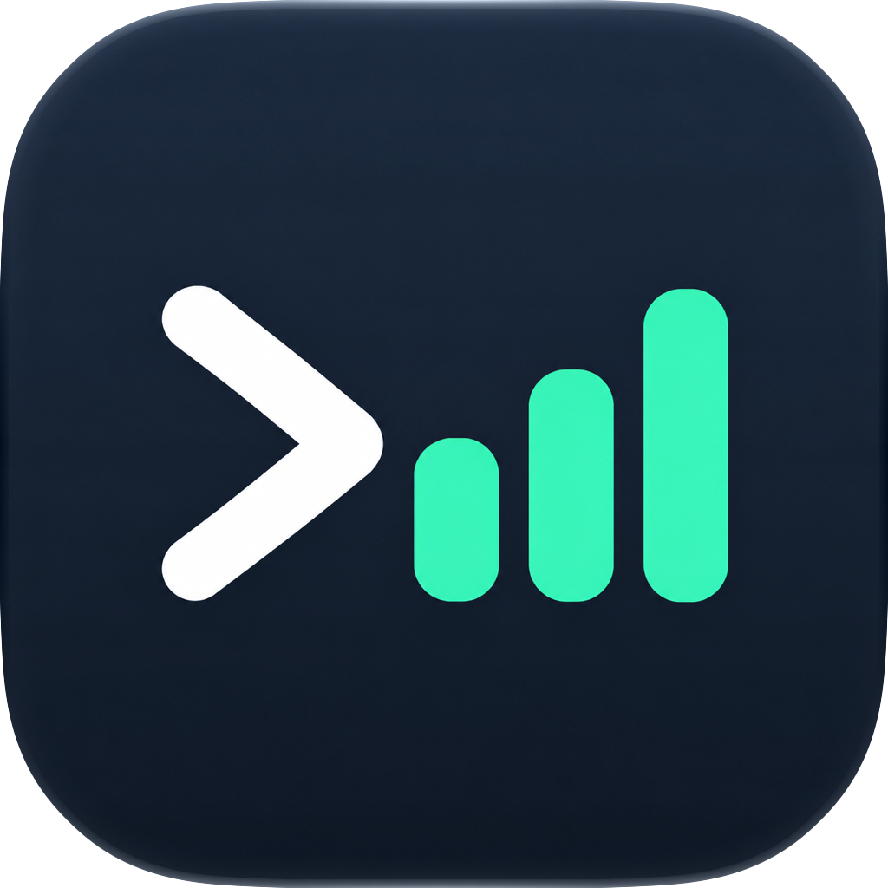
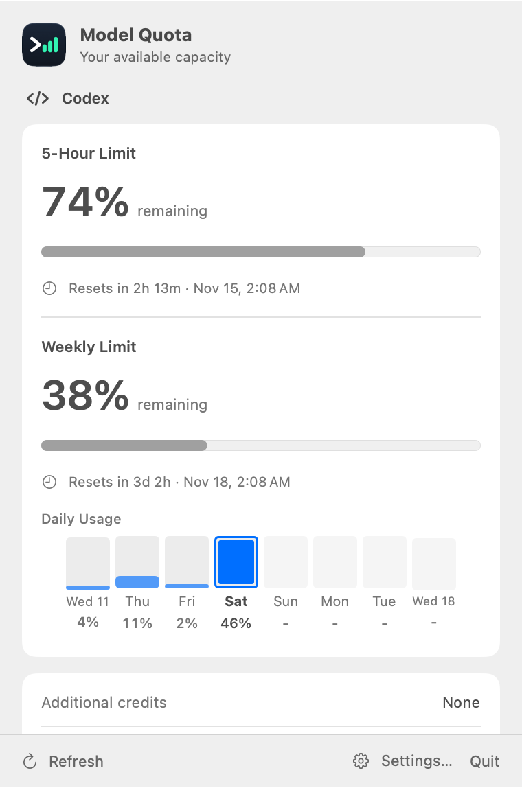

<p align="center">
  
</p>

<h1 align="center">Model Quota</h1>

<p align="center">A lightweight native macOS menu bar app that shows your remaining AI model quotas for Codex, Gemini, and Claude Code.</p>

This is an independent project, not an official OpenAI, Google, or Anthropic product.

<p align="center">
  <picture>
    <source media="(prefers-color-scheme: dark)" srcset=".github/screenshots/menubar-dark.png">
    
  </picture>
  <br><br>
  <picture>
    <source media="(prefers-color-scheme: dark)" srcset=".github/screenshots/popover-dark.png">
    
  </picture>
  <br>
  <sub>Menu bar item and popover, rendered with sample data.</sub>
</p>

## Features

The menu bar shows remaining percentages in a clean 2-row grid. Click it for quota details. The interface uses native macOS controls, system fonts, and light and dark appearances.

- Menu bar: left-aligned labels (`Codex`, `Gemini`, `Claude`) with right-aligned percentages (`74%`, `81%`), up to two rows per column, in the order you choose. A provider whose last read failed shows `?`.
- Popover: details for Codex, Gemini (Antigravity `agy`), and Claude Code, in their own order. It shows the remaining percentage, colored orange at 25% or less and red at 10% or less with a warning symbol. It also shows reset countdowns, a daily usage histogram labeled by weekday, and when each provider was last updated; each of these can be hidden. Last known values are dimmed while a provider is failing.
- Turn each provider on or off. A disabled provider is hidden and never run.
- Manual refresh, launch at login, configurable executable paths, and quit controls.
- Refreshes at startup and in background with zero credentials leaked.

## Install a downloaded app

**The app is not notarized by Apple or signed with a Developer ID certificate.** macOS may block the first launch. Continue only if you trust this project and the download source.

Download the ZIP and its `.sha256` file for Apple Silicon Macs from [Releases](https://github.com/changjo/model-quota/releases). To check the download, run this in the folder that holds both files; it should print `OK`:

```sh
shasum -a 256 -c Model-Quota-*-macos-arm64.zip.sha256
```

1. Extract the download and move **Model Quota.app** to **Applications**.
2. Open the app once. If macOS says it cannot verify the developer or check the app, dismiss the alert.
3. Open **System Settings → Privacy & Security** and select **Open Anyway** for this app in the Security section.
4. Confirm with **Open** and authenticate if macOS asks you to.

You can then open the app normally. It appears in the menu bar, without a Dock icon. Usage reads use the local CLI sessions (`codex` and `agy`).

This exception does not notarize the app. If **Open Anyway** is unavailable, or macOS reports damage or malware, stop and contact the download provider or your Mac administrator. See [Apple’s official instructions](https://support.apple.com/en-us/102445).

The [installation guide](INSTALL.md) is copied to `dist/INSTALL.md` during builds. Include it alongside the app in release archives.

## Build and run

The app requires macOS 14 or later. Local app bundle builds have been verified with Xcode 27, and release builds with Xcode 26.6 (the `macos-26` runner default); both compile the Icon Composer assets. The Swift sources use Swift 5.9 language mode and target macOS 14.

The app has no external Swift package, Electron, Node, or Python runtime dependencies.

```sh
./scripts/build-app.sh
open "dist/Model Quota.app"
```

The build script packages a release binary for the current Mac architecture and applies a local ad-hoc signature. It does not provide Developer ID signing, notarization, or a universal binary.

To build a release archive with the app, installation guide, and license:

```sh
./scripts/package-app.sh
```

This creates `dist/Model-Quota-<version>-macos-arm64.zip` on Apple Silicon and a matching `.sha256` checksum file. The filename uses the actual bundle version and binary architecture. The script verifies the extracted archive before producing the checksum. Upload only the intended ZIP and checksum, not the entire `dist` directory.

Published releases are built the same way by `.github/workflows/release.yml` on a GitHub-hosted Apple Silicon runner (`macos-26`). They carry the same ad-hoc signature and are not notarized.

### Compatibility and validation

The current binary has been tested on Apple Silicon with macOS 27, native Codex CLI, and Antigravity (`agy`). macOS 14 is the deployment target.

## Settings

Open **Settings…** from the popover or press **⌘,** while the app is active. Opening an already-running app from Finder also shows Settings. Settings has four tabs:

- **General**: Launch at Login, the menu bar and popover options below, and the app version, which is read from the installed bundle.
  - **Menu Bar**: the Limit Format and the provider **Order**. Providers fill the menu bar in this order, two rows per column. If every enabled provider is hidden from the menu bar, the first enabled provider in this order is shown.
  - **Popover**: switches for the **Daily Usage chart**, **Reset time**, and **Last updated** details (all on by default; they apply to every provider), and a separate provider **Order** for the popover sections. Every visible section always shows its remaining percentages, bars, and error messages; a provider hidden from the popover but shown in the menu bar still shows `?` there when its read fails. If every enabled provider is hidden from the popover, it says so and offers **Open Settings…** instead of showing one anyway.
  - Reorder providers with the up and down arrow buttons next to each name. A provider that is turned off is tagged **Off**. One hidden from the menu bar (in the Menu Bar list) or from the popover (in the Popover list) is tagged **Hidden**. Both stay in the lists, dimmed, so you can arrange them in advance.
- **Codex**, **Gemini**, and **Claude**: each tab has these controls.
  - **Enabled**: when off, the provider is hidden from the popover and menu bar, and its CLI is never run.
  - **Show in Menu Bar** and the menu bar label. An empty label uses the provider name.
  - **Show in Popover**: when off, the provider's section is left out of the popover. Its usage is still checked and still shown in the menu bar, and **Refresh** still refreshes it.
  - Connection status with **Refresh Now**.
  - The executable path.

Leave the executable path empty to search absolute directories in `PATH` and known installation locations (`/opt/homebrew/bin`, `/usr/local/bin`, `~/.local/bin`). If detection fails, choose the executable (`codex`, `agy`, or `claude`) and click **Apply**. Invalid paths are rejected without saving them or interrupting the existing connection. **Use Automatic Detection** restores the default search.

Authentication is handled by the CLI. If the app reports a sign-in problem, check the CLI login in Terminal.

Enable **General → Launch at Login** to start the app when you sign in to your Mac. The app does not register automatically on first launch; the switch reflects the actual macOS registration status. If approval is required, use **Open System Settings…** or **Turn Off**. Changes take effect immediately without clicking Apply. Move the app to its final location before enabling this option.

## How it works and privacy

The app maintains one `codex app-server` child process and communicates over local stdio JSONL. The official CLI handles existing authentication and network requests. The app does not directly access cookies, authentication files, the browser Keychain, or private HTTP endpoints.

Usage and account responses are kept in memory. Settings (CLI paths, labels, provider and menu bar preferences) are saved in UserDefaults. To draw the daily usage histogram, the app also stores each provider's weekly usage history: daily percentages, reset times, and the Codex account identifier. It never stores credentials or tokens. This history lives in UserDefaults and `~/Library/Application Support/Model Quota/`, limited to the 12 most recent cycles. Launch at login uses Apple’s `SMAppService.mainApp`, with registration state managed by macOS.

Claude and Gemini usage is read by briefly running the official CLIs: `claude --print` with a `get_usage` control request, which never starts a model turn, and `agy --print /usage`. Each provider is checked once a minute. After a failure, the interval doubles up to 5 minutes. A provider you turn off in Settings is never run.

The app does not request Full Disk Access, Accessibility, or Screen Recording permissions. Mac App Sandbox is not enabled. The CLI may write its own state under `~/.codex`.

Usage notifications may contain partial responses, so the app requests a fresh snapshot. Notifications for unrelated usage buckets are ignored. If a request fails, the menu bar shows `?` for that provider. Any retained popover values are dimmed and labeled as the last known usage. Account changes clear previous values. The app cleans up its child process on quit, sleep, and executable path changes.

General ChatGPT per-model message quotas and low-usage alerts are not included.

## Development and testing

### Version policy

Releases are automatic. When a push to `main` changes `CFBundleShortVersionString` in `Resources/Info.plist` to a version that has no `v<version>` tag, GitHub Actions runs the tests, builds the archive with `scripts/package-app.sh`, and publishes a GitHub Release with the ZIP and its checksum. Change the version only for an intended release, and increase `CFBundleVersion` by hand in the same commit. CI never edits either value. Versions use `X.Y.Z`.

Earlier internal development notes used 0.2.x and 0.3.0 as work markers; these were not public releases.

### Tests

```sh
swift test --disable-sandbox
```

Only the fake stdio server used by tests requires `/usr/bin/python3` from the macOS developer tools. Tests run without a real account or network access and cover response parsing, CLI discovery, initialization, errors, timeouts, EOF, notifications, process cleanup, and presentation state.

Launch-at-login tests substitute the OS registration boundary to cover registration and removal failures, pending approval, overlapping requests, and external status changes.

App views and lifecycle code are in `Sources/ModelQuota`. Models, connection handling, and state management are in `Sources/ModelQuotaCore`.

To check application termination signals, quit any running instance first, then run:

```sh
python3 scripts/test-app-lifecycle.py "dist/Model Quota.app/Contents/MacOS/ModelQuota"
```

This check briefly launches the app with its normal CLI configuration and may read usage from your account.

Render the production SwiftUI views with sample data in light and dark appearances. The renders cover popover states, every Settings tab, and the menu bar image:

```sh
./scripts/render-ui.sh
```

Images are saved to `.build/ui-previews`. This checks layout separately from live menu bar interaction tests. The README screenshots in `.github/screenshots` are copies of `two-limits-*` (popover) and `menubar-3-*` (menu bar).

The icon source is `Resources/AppIcon.icon`; an exported PNG is available at `Resources/AppIcon.png`.

## Initial protocol investigation

On September 19, 2026, a live `account/rateLimits/read` request succeeded with Codex CLI `0.155.0`. The observed account had a weekly `primary` window and no `secondary` window. Do not assume that `primary` always means a five-hour window.

- [Swift protocol probe](experiments/rate-limits-probe.swift)
- [Sample response with account and credit identifiers redacted](experiments/response-redacted.json)
- [Related schemas generated from the installed CLI](experiments/schema/0.155.0/)

Run the probe from the project directory:

```sh
swift experiments/rate-limits-probe.swift "$(command -v codex)"
```

To read once and then observe notifications for 60 seconds without polling:

```sh
swift experiments/rate-limits-probe.swift "$(command -v codex)" 60
```

The CLI must already be signed in. The probe launches only the official CLI using `Process` and `Pipe`. It does not read browser cookies or authentication files, scrape websites, implement login, or run model requests. The CLI manages its own authentication, local state, and network access.

The probe is an investigation tool, not the production app client. Automatic reconnection, application lifecycle handling, user-facing errors, and GUI executable discovery are implemented separately in the app sources.

## License

Original project code and assets are provided under the [MIT License](LICENSE).
The generated Codex protocol schemas in `experiments/schema/` retain their
[upstream Apache-2.0 license and notices](experiments/schema/README.md).
The official Codex CLI is installed separately and is not bundled with this app.
